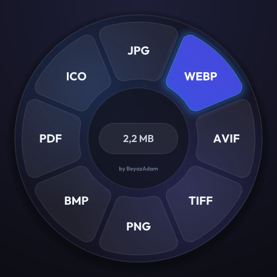

<div align="center">


# 🍊 Mandalina — Görsel & PDF Sıkıştırıcı / Image & PDF Compressor

**Çevrimdışı, sistem tepsisinde yaşayan, Shift + sürükle format çarklı sıkıştırıcı ve dönüştürücü**<br>
*Offline, tray-based compressor & converter with a Shift + drag format wheel*

<p align="center">
  <a href="https://github.com/BeyazAdam">
    
  </a>
  <a href="https://github.com/BeyazAdam/mandalina-rs">
    
  </a>
  <a href="https://beyazadam.github.io/mandalina-rs/">
    
  </a>
  <a href="https://github.com/BeyazAdam/mandalina-rs/releases/latest">
    
  </a>
</p>

<p align="center">
  <a href="https://github.com/BeyazAdam/mandalina-rs/actions/workflows/ci.yml"></a>
  <a href="LICENSE"></a>
  <a href="https://www.rust-lang.org"></a>
  
</p>



[🇹🇷 Türkçe](#-türkçe) · [🇬🇧 English](#-english)

</div>

---

## 🇹🇷 Türkçe

Merhaba! Ben **[BeyazAdam](https://github.com/BeyazAdam)**.

Bir görseli WebP'ye çevirmek ya da bir PDF'i e-postaya sığacak kadar küçültmek için çoğu zaman
dosyayı bilinmeyen bir siteye yüklemek zorunda kalıyoruz. **Mandalina** bunu bitirmek için yazıldı:
sistem tepsisinde sessizce bekler, dosyalarınızı **tamamen kendi bilgisayarınızda** işler.
Hiçbir şey yüklenmez; uygulamada tek satır ağ kodu bile yoktur.

> [!TIP]
> 🚀 Dosyayı Explorer'dan sürüklerken <kbd>Shift</kbd>'e basılı tutun: imlecin altında format çarkı açılır.
> Bir dilime bırakın, dönüştürülsün; ortadaki hapa bırakın, sıkıştırılsın. Menü yok, pencere yok.

### ✨ Özellikler

| | Özellik | Açıklama |
| :---: | :--- | :--- |
| 🎯 | **Shift + sürükle çarkı** | JPG, WEBP, AVIF, TIFF, PNG, BMP, ICO, PDF'e tek hamlede dönüştürme ya da sıkıştırma |
| 🖼️ | **Görsel sıkıştırma** | Kalite ayarları, maksimum çözünürlük, EXIF/XMP temizleme (yönlendirme önce piksellere uygulanır, fotoğraflar yan dönmez) |
| 📄 | **PDF optimizasyonu** | Gömülü görselleri yeniden kodlar ve küçültür, kullanılmayan nesneleri temizler; görselleri tek PDF'te birleştirir |
| 📂 | **İzlenen klasör** | `Resimler/Sıkıştırılacaklar` klasörüne atılan her şey otomatik sıkıştırılır |
| 📋 | **Pano** | Panodaki görseli istendiğinde ya da otomatik sıkıştırır |
| ⚡ | **Paralel** | Toplu işler `rayon` havuzunda çalışır; tepsi menüsü canlı ilerleme ve toplam tasarrufu gösterir |
| 🪶 | **Hafif** | Yazı tipi dahil ~7 MB tek dosya, ~17 MB bellek, boştayken sıfıra yakın CPU |

> [!IMPORTANT]
> Çıktılar her zaman kaynağın yanındaki `Sıkıştırılmış/` klasörüne yazılır. **Orijinal dosyalara
> dokunulmaz**; sıkıştırınca büyüyecek bir dosya olduğu gibi kopyalanır.

### 📥 Kurulum

**Hazır sürüm:** [Releases](https://github.com/BeyazAdam/mandalina-rs/releases/latest) sayfasından
`mandalina-*-windows-x64.zip` dosyasını indirin, açın ve `mandalina.exe`'yi çalıştırın. Kurulum gerekmez.

**Kaynaktan derleme** (Rust 1.90+, Windows'ta MSVC derleme araçları gerekir):

```bash
git clone https://github.com/BeyazAdam/mandalina-rs
cd mandalina-rs
cargo build --release
```

Çalıştırılabilir dosya: `target/release/mandalina.exe`

### 🕹️ Kullanım

| İşlem | Nasıl |
| :--- | :--- |
| Dosya dönüştürme | <kbd>Shift</kbd> + sürükleyip çarkta bir dilime bırakın |
| Dosya sıkıştırma | <kbd>Shift</kbd> + sürükleyip ortadaki hapa bırakın |
| Görsellerden tek PDF | Birden çok görseli <kbd>Shift</kbd> + sürükleyip **PDF** dilimine bırakın |
| Dosya / klasör seçme | Tepsi menüsü → *Dosya seç…* / *Klasör seç…* |
| Kalite, boyut, çıktı formatı | Tepsi menüsündeki alt menüler |
| Çarkı kapatma | Tepsi menüsü → *Shift + sürükle çarkı* |

### 🔒 Gizlilik ve Güvenlik

- Tamamen çevrimdışı çalışır; telemetri ya da güncelleme denetimi yoktur.
- <kbd>Shift</kbd> basılıyken Explorer sürüklemeyi "taşı" olarak başlatır. Çark her zaman
  "kopyala" yanıtı verir; kaynak dosya asla taşınmaz veya silinmez.
- Genel klavye kancası (hook) kurulmaz; tetikleyici yalnızca Shift ve fare tuşunun durumunu yoklar.

### ⚠️ Sınırlamalar

> [!NOTE]
> Çark şimdilik yalnızca Windows'ta çalışır (geri kalanı diğer platformlarda da derlenir).
> HEIC ve DOCX desteklenmez: açık, saf Rust bir HEIC kodlayıcısı yoktur; DOCX ise bir belge
> motoru gerektirir. AVIF yalnızca çıktı olarak desteklenir.

### 🤝 Katkıda Bulunma

Issue ve pull request'ler memnuniyetle karşılanır. PR açmadan önce şunları çalıştırın:

```bash
cargo fmt --all
cargo clippy --all-targets -- -D warnings
cargo test
```

---

## 🇬🇧 English

Hi! I'm **[BeyazAdam](https://github.com/BeyazAdam)**.

Converting an image to WebP or shrinking a PDF to fit an email usually means uploading it to some
unknown website. **Mandalina** exists to end that: it waits quietly in your system tray and processes
your files **entirely on your machine**. Nothing is uploaded; the app contains no networking code at all.

> [!TIP]
> 🚀 Hold <kbd>Shift</kbd> while dragging files from Explorer and a format wheel opens under your cursor.
> Drop on a slice to convert, drop on the center pill to compress. No menus, no windows.

### ✨ Features

| | Feature | Description |
| :---: | :--- | :--- |
| 🎯 | **Shift + drag wheel** | One-gesture conversion to JPG, WEBP, AVIF, TIFF, PNG, BMP, ICO, PDF — or compression |
| 🖼️ | **Image compression** | Quality presets, max-resolution limits, EXIF/XMP stripping (orientation is applied to the pixels first, so photos never end up sideways) |
| 📄 | **PDF optimisation** | Re-encodes and downsamples embedded images, prunes unused objects; merges images into one PDF |
| 📂 | **Watch folder** | Anything dropped into `Pictures/Sıkıştırılacaklar` is compressed automatically |
| 📋 | **Clipboard** | Compresses the clipboard image on demand or automatically |
| ⚡ | **Parallel** | Batch jobs run on a `rayon` pool; the tray shows live progress and total savings |
| 🪶 | **Lightweight** | ~7 MB single binary (font included), ~17 MB RAM, near-zero CPU when idle |

> [!IMPORTANT]
> Output always goes to a `Sıkıştırılmış/` folder next to the source. **Originals are never
> modified**, and a file that would get bigger is copied as-is.

### 📥 Installation

**Prebuilt:** grab `mandalina-*-windows-x64.zip` from
[Releases](https://github.com/BeyazAdam/mandalina-rs/releases/latest), unzip, run `mandalina.exe`. No installer.

**From source** (Rust 1.90+, Windows needs the MSVC build tools):

```bash
git clone https://github.com/BeyazAdam/mandalina-rs
cd mandalina-rs
cargo build --release
```

The binary is `target/release/mandalina.exe`.

### 🕹️ Usage

| Action | How |
| :--- | :--- |
| Convert a file | <kbd>Shift</kbd> + drag it onto a wheel slice |
| Compress a file | <kbd>Shift</kbd> + drag it onto the center pill |
| Images → one PDF | <kbd>Shift</kbd> + drag several images onto **PDF** |
| Pick files / a folder | Tray menu → *Dosya seç…* / *Klasör seç…* |
| Quality, max size, output format | Tray menu submenus |
| Turn the wheel off | Tray menu → *Shift + sürükle çarkı* |

### 🔒 Privacy & Safety

- Runs fully offline; no telemetry, no update checks.
- With <kbd>Shift</kbd> held, Explorer starts the drag as a *move*. The wheel always answers
  *copy*, so the source file is never moved or deleted.
- No global keyboard hook: the trigger only polls the Shift/mouse button state.

### ⚠️ Limitations

> [!NOTE]
> The wheel is Windows-only for now (the rest compiles elsewhere). HEIC and DOCX are not supported:
> there is no open pure-Rust HEIC encoder, and DOCX needs a document engine. AVIF is output-only.

### 🤝 Contributing

Issues and pull requests are welcome. Please run `cargo fmt --all`,
`cargo clippy --all-targets -- -D warnings` and `cargo test` before opening a PR.

---

## 📂 Detaylı Belgeler / Detailed Docs

- 🏗️ **[Mimari / Architecture](docs/ARCHITECTURE.md)** — iş parçacığı modeli, çark, renk paleti / threading model, wheel, palette
- 📝 **[Değişiklik Günlüğü / Changelog](CHANGELOG.md)**
- 🎨 Tema, [unreal-engine-version-guide](https://github.com/BeyazAdam/unreal-engine-version-guide) sayfasının "glass" stilini izler / The theme follows the glass style of my UE guide.

## 📜 Lisans / License

[MIT](LICENSE) © BeyazAdam. Gömülü Outfit yazı tipi / The embedded Outfit font: [SIL OFL 1.1](assets/fonts/OFL.txt).

<div align="center">

⭐ Beğendiyseniz yıldız vermeyi unutmayın! / If you like it, leave a star!

</div>
